

  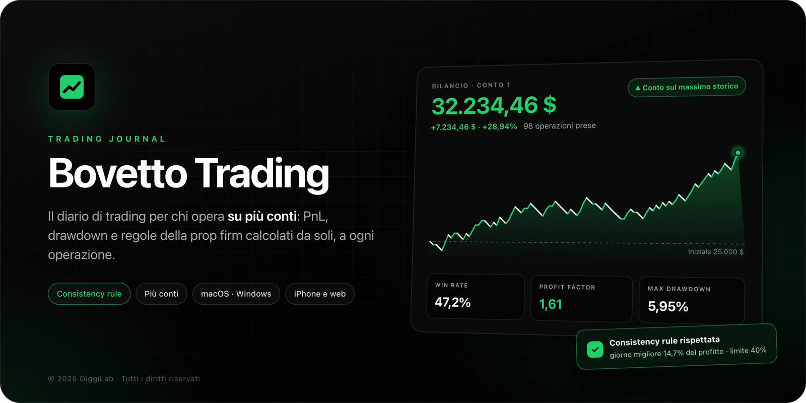

  <a href="https://github.com/GiggiLab/bvjournal/releases/latest/download/Bovetto-Trading-arm64.dmg">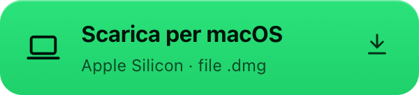</a>&nbsp;
  <a href="https://github.com/GiggiLab/bvjournal/releases/latest/download/Bovetto-Trading-Setup.exe">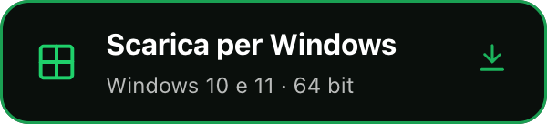</a>&nbsp;
  <a href="https://bovettotradingapp.web.app">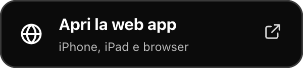</a>

  

**Bovetto Trading** è il diario di trading per chi opera su più conti, dalle challenge delle prop firm al conto personale. Registri ogni operazione in pochi secondi: l'app calcola da sola PnL, profitto cumulato, bilancio, drawdown e statistiche, e ti mostra in ogni momento se stai rispettando le regole del conto.

## Novità della versione 1.0.2

### Consistency rule

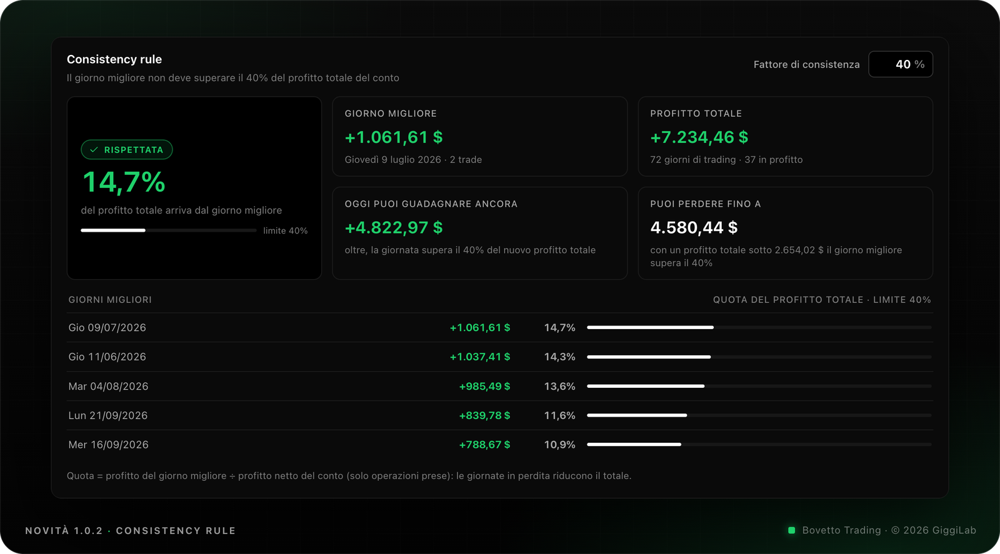

Molte prop firm chiedono che nessuna giornata pesi troppo sul profitto totale. Bovetto lo controlla per te:

- imposti il **fattore di consistenza** del conto (per esempio 30%, 40% o 50%) direttamente nella sezione;
- vedi subito se la regola è **rispettata**, quanto pesa il giorno migliore e quali giornate si avvicinano al limite;
- sai **quanto puoi ancora guadagnare oggi** senza superare il limite e **quanto puoi perdere** prima di violarlo;
- se la regola non è rispettata, l'app ti dice **quanto profitto manca** per rientrare.

### Una sola operazione, tutti i conti

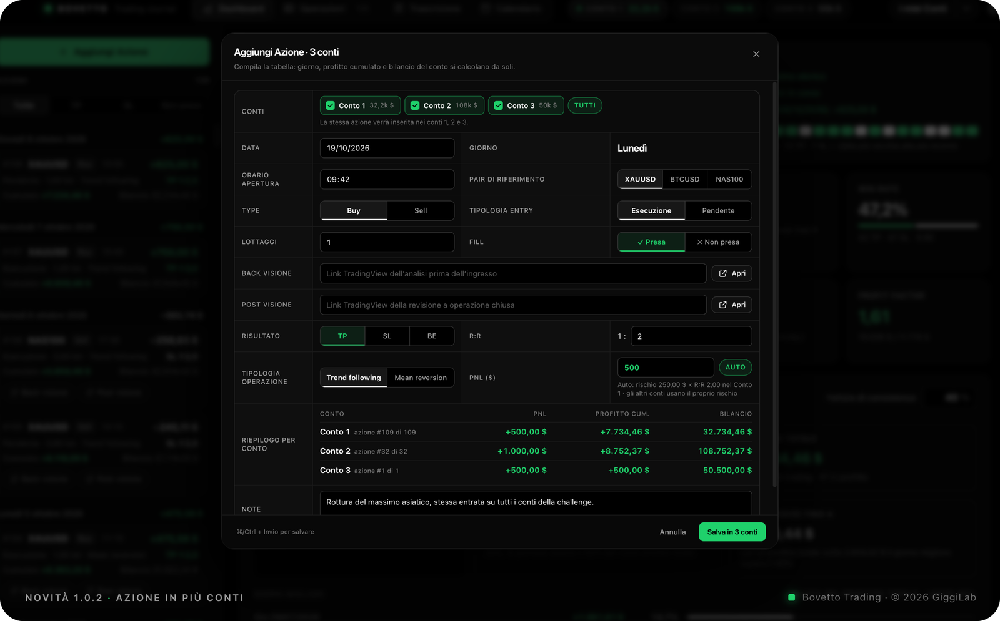

Se replichi la stessa entrata su più conti, la inserisci una volta sola: spunti i conti (o premi **Tutti**) e Bovetto crea l'operazione in ognuno. Il PnL automatico usa il rischio di ciascun conto, e prima di salvare il riepilogo ti mostra PnL, profitto cumulato e bilancio di ogni conto.

## Tutto il tuo journal in un'app

### Dashboard

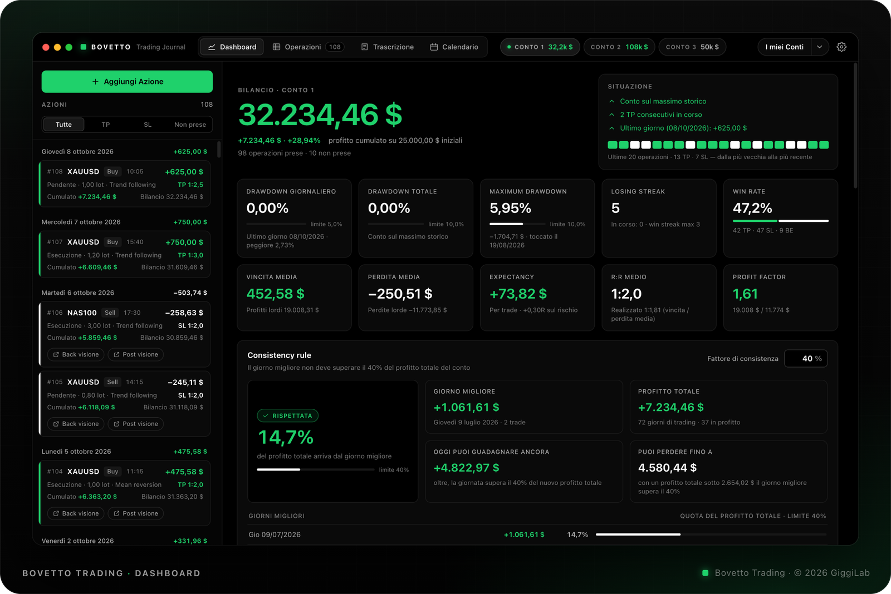

- Bilancio del conto e riquadro **Situazione**: massimo storico, serie di TP e SL in corso, avvisi sui limiti di drawdown.
- Dieci metriche: drawdown giornaliero, totale e massimo con i limiti del conto, losing streak, win rate, vincita e perdita media, expectancy, R:R e profit factor.
- Colonna delle operazioni divise per giorno, con i link TradingView dell'analisi e della revisione.
- Un pulsante per ogni conto nella barra in alto e la tendina **I miei Conti** per passare da uno all'altro.

### Grafici e analisi

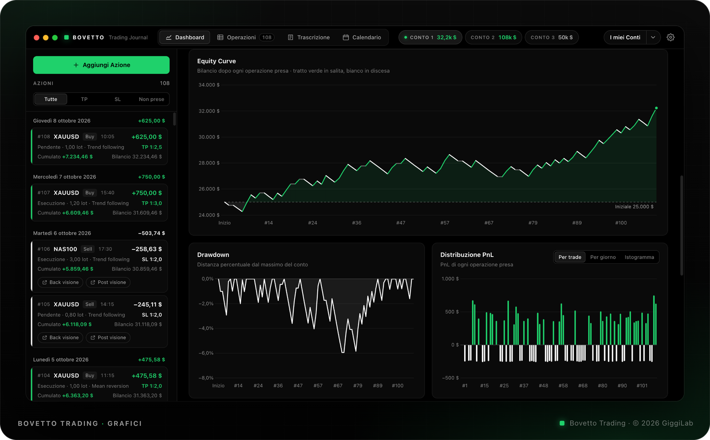

Equity curve, drawdown e distribuzione del PnL (per trade, per giorno o come istogramma), più l'analisi per pair, tipologia, giorno, entry, direzione e orario. Il **modulo grafici** salva tutto in PNG, insieme a un report completo.

### Calendario

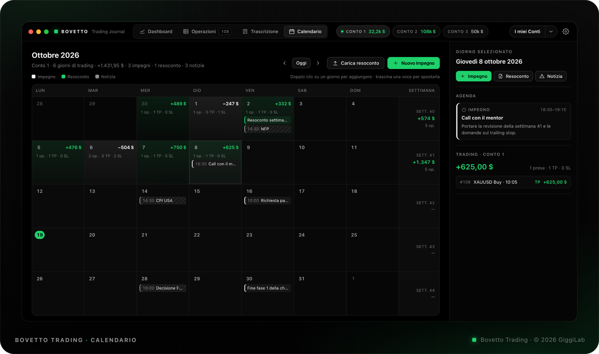

Il PnL di ogni giornata e di ogni settimana, insieme a impegni, notizie macro e resoconti con allegati: PDF, immagini, fogli di calcolo.

### Trascrizione

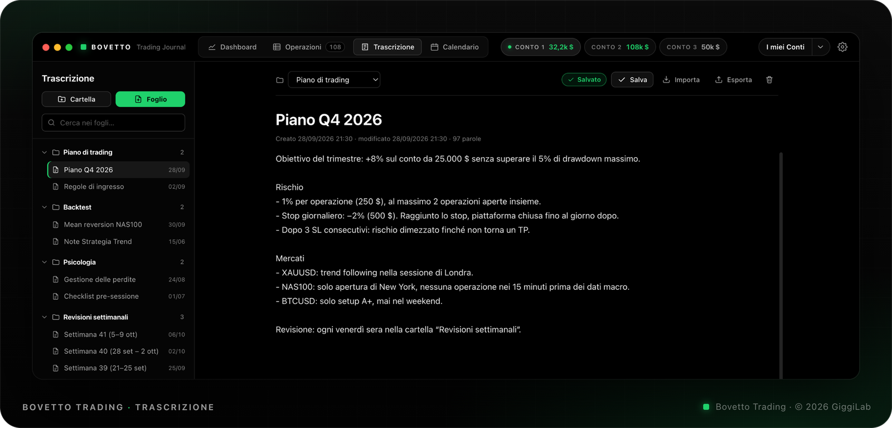

Piani di trading, backtest e revisioni settimanali in fogli divisi per cartelle, con foto, video, tabelle e documenti direttamente nel testo.

### Sul telefono

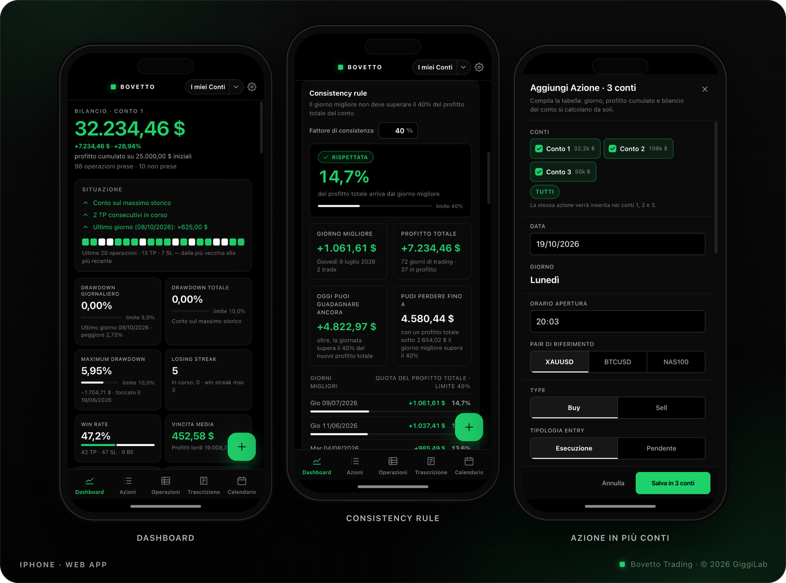

La web app si installa sulla schermata Home di iPhone e iPad ed è sincronizzata con l'app desktop: inserisci un'operazione dal telefono e la ritrovi sul computer.

## Installazione

**macOS** (Apple Silicon)

1. Scarica `Bovetto-Trading-arm64.dmg` e trascina **Bovetto Trading** nella cartella Applicazioni.
2. Alla prima apertura macOS può bloccare l'app perché non arriva dall'App Store: vai in **Impostazioni di Sistema › Privacy e sicurezza** e premi **Apri comunque**.

**Windows** (10 e 11, 64 bit)

1. Scarica ed esegui `Bovetto-Trading-Setup.exe`.
2. Se compare la schermata di Microsoft Defender SmartScreen, scegli **Ulteriori informazioni › Esegui comunque**.

**iPhone e iPad**

Apri la [web app](https://bovettotradingapp.web.app) in Safari e tocca **Condividi › Aggiungi alla schermata Home**.

Gli aggiornamenti sono automatici: quando esce una nuova versione, l'app desktop te lo segnala e si aggiorna con un clic.

## Account e dati

- Si accede con un account Bovetto: gli account vengono creati su invito.
- I dati sono sincronizzati nel cloud e ogni account vede soltanto i propri.
- Da **I miei Conti** puoi esportare in qualsiasi momento un backup completo o le operazioni in CSV.

---

  © 2026 GiggiLab · Tutti i diritti riservati. Il codice sorgente non è pubblico; nome, marchio e immagini di questo repository non possono essere riutilizzati senza permesso.

